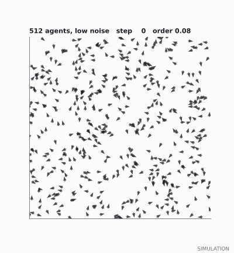
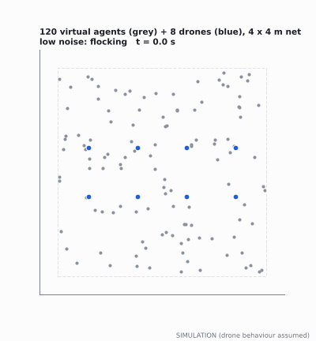

# LIMINAL Layer 2: swarm simulations and the first FPGA module

LIMINAL is a swarm of drones for search and rescue in places with no GPS. Layer 2
is the swarm layer: many cheap drones that flock, spread out and decide together
without a commander. This repository holds the simulations behind Layer 2 and the
first piece of FPGA hardware that will run the swarm maths.

> **Everything here is simulation.** No result in this repository comes from a
> flight. Drone behaviour (response time, disturbances, camera noise) is assumed
> until it can be measured on the motion-capture rig, and every figure is marked
> SIMULATION.

 

## What is in here

| Folder | Contents |
| --- | --- |
| `liminal_sim/` | The models: the Vicsek flock, its fixed-point (FPGA) version, the hybrid real-plus-virtual flock, the criticality controller, the topology layer (rooms, doorways, pockets) with exploration, Doppler sound localisation, Turing-pattern coverage, stopping rules for a search, a UGV steering the flock, the flock as a reservoir computer, Koopman/DMD prediction, multi-drone search with marks or a mesh radio, and estimators for missing reports and clock skew |
| `experiments/` | One script per result; each regenerates its own data in `results/data/` |
| `results/figures/` | The figures and animations |
| `fpga/` | The Vicsek agent engine in Verilog, its testbench, and a one-command Vivado build |
| `groundstation/` | The demo's control loop: laptop, flock engine and drones as separate programs talking over UDP |
| `docs/report.html` | The full write-up: every result explained from scratch |
| `docs/explorer.html` | The flock running live in a browser, with a noise dial |
| `docs/layer2_demo.html` | Three Layer 2 mechanisms live in a browser: flocking with a noise sweep, reaction-diffusion patterns, and counting unexplored map regions |
| `tests/` | Automatic checks (run `pytest`) |

## Results in one screen

All of these are simulation results. The report explains each one.

- **FPGA engine:** the Verilog Vicsek engine matches the Python model bit for bit in all eleven simulation checks (64 to 256 agents, 1 to 64 lanes, the walled demo arena with drone positions written every step, and a recorded ground-station session). It flies the demo like the exact model (report Figure 4). One demo step is 1,592 clock ticks, about 6.4 microseconds at an assumed 250 MHz that Vivado has not yet confirmed. An open-source estimate for 4,096 agents and 16 lanes: about 12% of the XCKU5P's logic and 2% of its DSP slices.
- **Integer maths:** the FPGA-style 16-bit model's heading error is 0.028° median and 0.15° worst; its order and fluctuation curves match the exact model.
- **Flock size:** 8 agents show no peak, only a plateau of fluctuations (0.24, against 0.20 for random headings) up to the end of the sweep; a clear peak appears from 32 agents and reaches about 70 at 4,096, at noise 1.8 to 2.2 (report Figure 2).
- **Hybrid demo:** about 128 agents (120 virtual + 8 drones) fit a 4 x 4 m net; thousands do not. In an ordered flock drone misalignment is 13° at 20 ms loop latency, 15° at 100 ms, 19° at 200 ms and 30° at 400 ms, so keep the loop under about 100 ms. Without a safety layer two drones came within 1.8 cm; a 0.5 m push-apart layer kept them at least 38 cm apart (report Figures 5 to 7).
- **Demo loop over UDP, in real time:** the ground-station program, the engine (the FPGA's integer model as a UDP server) and simulated drones run as separate processes. Drones follow the flock with 13.6° misalignment over 6 runs (offline: 13.7°); 99% of ticks are within 0.27 ms of 20 ms (the worst was 14.2 ms off); the engine answers in about 0.34 ms; if it goes silent, the drones hover and rejoin when it returns. A recorded session replayed through the Verilog matches bit for bit (report Figure 11).
- **Topology layer (Sim 9):** a 40 x 30 m collapsed floor reduces to a room graph of 24 rooms and 23 doorways, 283 bytes against a 30 KB map (1.4 KB compressed), so drones can share layouts over a weak radio. The pocket detector does not work yet: during a search it flagged only 3 of 89 still-unseen real pockets (at 4 minutes). Pockets-first raised a gain-driven planner's pocket-victim rate (69% to 81% in 10 min) through flags on other walled-in patches, and changed nearest-frontier on only 3 of 30 floors (report Figure 12).
- **Doppler sound localisation (Sim 10):** one microphone on one drone, one L-shaped pass, locates a steady tone (alarm, phone, beacon) within 1 m in 100% of trials at 40 dB or more (median 3-4 cm), but 10% at 30 dB and 0% at 20 dB. A straight pass cannot tell left from right; a source whose pitch wanders by 0.5 Hz/sqrt(s) drops it to 57%. No echoes simulated (report Figure 13).
- **Turing-pattern coverage (Sim 11):** spot spacing follows the square-root law (slope 0.48). Eight drones search 90% of 32 x 32 m in 41 s with Lloyd/Voronoi and about 48-49 s with the Turing field, a greedy nearest-unsearched rule or lawnmower strips; the Turing field alone stalls at 97% and needs a mop-up rule. With 3 drones lost, all but the random walk still reach 90% (66-69 s). The Turing field is not faster than simple rules; its case is that it is a local, FPGA-friendly rule (report Figure 14).
- **When is a search finished? (Sim 12):** on the Sim 9 floors, exploring until no frontier is left found every victim (12.3 min on average; a 10-minute limit misses 14%), but left about 31 m² of open floor per floor unseen (more than 5 m² on 15 of 30 floors), mostly behind gaps narrower than the drone. A topological audit of the final map (unseen regions with an opening, and large closed-off ones) reports all but 0.4 m² of it, at the cost of about 5.6 flags per floor, of which 31 of 168 held at least 1 m² of open floor; most of the rest are rubble cores. Flying back to look again cost 3.3 minutes and found nothing more (report Figure 15).
- **A UGV steering the flock without radio (Sim 13):** drones that see a ground robot weigh its heading; the share of a 128-drone flock's motion that follows it is 0.89 at low noise (eta 1) but 0.30 at the flock's fluctuation peak (eta 3), against about 0 with no UGV and 0.60 with a radio command to every drone. One UGV's grip weakens as the flock grows (0.93 / 0.89 / 0.80 for 32 / 128 / 512 drones at eta 1); four UGVs in 512 restore it (0.33 at eta 3), but they sat on a regular grid with one shared heading, so how many a real flock needs is open.
- **The flock as a reservoir computer (Sim 14):** with a UGV feeding a random input, a linear readout recovers the current input (r^2 0.41 at low noise, 0.23 at eta 3) but hardly any memory (0.11 of a possible 10, against 8.8 for a 51-node software reservoir); it computes best when calm, not at the critical point, and two copies driven by the same input agree only weakly (feature correlation 0.27 at most). Not a working part of LIMINAL; a research question.
- **Koopman/DMD prediction (Sim 15):** on its own the flock's order is predicted no better than by a one-number model, and not beyond about 100 steps; its heading no better than "keeps going". Told the UGV's moves, the linear model predicts the heading 500 steps ahead within 16 degrees (eta 1), but a one-number smoother given the same moves gets 17, so the 51-number model adds nothing; corrected after an independent review.
- **Marks instead of radio (Sim 16):** six drones, 20 collapsed floors, radio jammed. Data tags every 10 m (about 190 per floor) recover 76% of the time a jammed radio costs (90% searched in 5.6 min, against 5.1 with an ideal radio and 7.3 with no sharing); a second wave reading the first wave's 39 tags is as fast as one handed its whole map. Simple marks need about 700 to 2,500 per floor for a similar or smaller gain and tell a later wave little.
- **The communication layer (Sim 17):** merging searched-maps by set union (a grow-only set, conflict-free by construction) cannot invent coverage, and a 5-20 m mesh that is split up to 76% of the time searches within about 10 s of an ideal radio. With few reports the order parameter reads a disordered flock as ordered (8 reports: 0.33 for a true 0.12); a sample-size correction fixes this when reports go missing at random (0.14), not when they come from one part of the flock (0.37). Clock offsets of about a second or less hardly matter; tens of seconds inflate the susceptibility up to about 4 times.
- **Tested and set aside:** short-range repulsion for every agent saves the drone safety layer work only by costing drone alignment, and alone it does not keep drones apart; a local order measure matches the whole-flock one while the flock is ordered (report Figure 10).
- **Controller:** extremum seeking on the fluctuations settles at noise 2.55 and 2.52 for 512 agents, inside the sweep's broad maximum (2.3-2.7).
- **Honest speed check:** one cloud CPU core runs 4,096 agents at about 340 steps per second, so the FPGA's case rests on much larger flocks, fixed timing and standalone operation, not on this demo's size.

Read [docs/report.html](docs/report.html) for what each result means and how it
was produced.

## Run it

Python 3.10 or newer:

```
pip install -r requirements.txt
pytest                                   # quick checks, about 40 s
python experiments/exp2_fixed_vs_float.py
python experiments/exp3_finite_size.py   # the long one: about an hour on 2 cores
python experiments/exp3b_large_n_repeats.py   # extra runs for 2,048 and 4,096 agents: about 1.5 hours
python experiments/exp4_hybrid.py
python experiments/exp4b_hybrid_knn.py
python experiments/exp4d_hybrid_recommended.py
python experiments/exp4e_repulsion_local_order.py
python experiments/exp7_fixed_hybrid.py         # the FPGA's integer engine in the demo loop
python experiments/exp8_groundstation.py        # the demo loop over UDP, real time: about 9 minutes
python -m groundstation.run_demo --viewer       # one live run with a window
python experiments/exp9_topology.py             # room graph, pockets, exploration: 7 to 15 minutes
python experiments/exp10_doppler.py             # Doppler sound localisation: about 6 minutes
python experiments/exp11_turing.py              # Turing-pattern coverage: about 4 minutes
python experiments/exp12_stopping.py            # when is a search finished: about 5 minutes
python experiments/exp13_ugv.py                 # a UGV steering the flock: about 9 minutes
python experiments/exp14_reservoir.py           # the flock as a reservoir computer: about 7 minutes
python experiments/exp15_koopman.py             # Koopman/DMD prediction: about 7 minutes
python experiments/exp16_stigmergy.py           # marks instead of radio: about 20 minutes
python experiments/exp17_comm.py                # mesh radio, missing reports, clock skew (needs exp16 first)
python experiments/exp5_neighbour_cost.py
python experiments/exp6_control.py
python experiments/exp_cpu_timing.py
python experiments/make_figures.py
python experiments/make_animations.py
python experiments/make_report.py
```

Every run uses fixed random seeds, so the figures come out the same each time, except the real-time
ground-station runs (Sim 8), whose timing depends on the computer.
The FPGA checks need Icarus Verilog (`cd fpga/sim && sh run_iverilog.sh`; eleven lines, all PASS); the Vivado
build is described in [fpga/README.md](fpga/README.md).

## Licence

All rights reserved; see [LICENSE](LICENSE). The code is public so it can be read and checked, not reused.
